# Lost & Hidden Atlas

A map for finding old buildings, ruins and what is left of them, made for a phone in the field. More than 5,000 places across the United States and Canada, each with what is there now, whose land it is and how to reach it legally.

**Open it:** https://mrroot3r.github.io/Lost-and-Hidden-Atlas/

**Android app:** the newest build is at https://github.com/mrroot3r/Lost-and-Hidden-Atlas/releases/latest (download `lost-hidden-atlas.apk` on the phone and open it). The app opens with no signal, fetches new places from the site by itself, and records a field log with the screen off.

It is free and there is no account. Notes, favourites, trips and field logs stay on your own phone; none of it is sent anywhere unless you press a button that sends a report.

## What it does

<table>
<tr>
<td width="33%" valign="top"><a href="docs/features/01-map.jpg">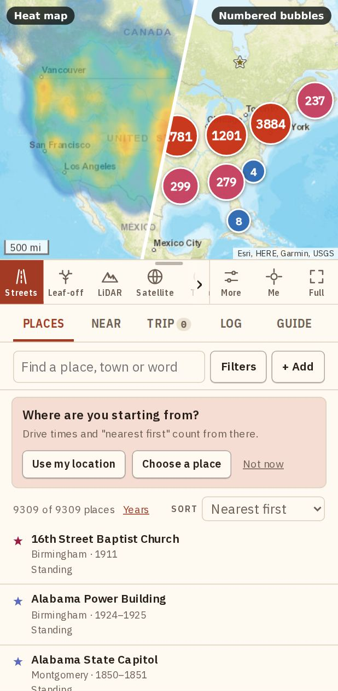</a> <b>The whole map</b> More than 9,300 old places across the United States and Canada. Zoomed out, numbered bubbles count them, or a heat map shows where they are thick: blue for a few, red for many. The picture shows half of each; you choose under the gear.</td>
<td width="33%" valign="top"><a href="docs/features/02-place.jpg">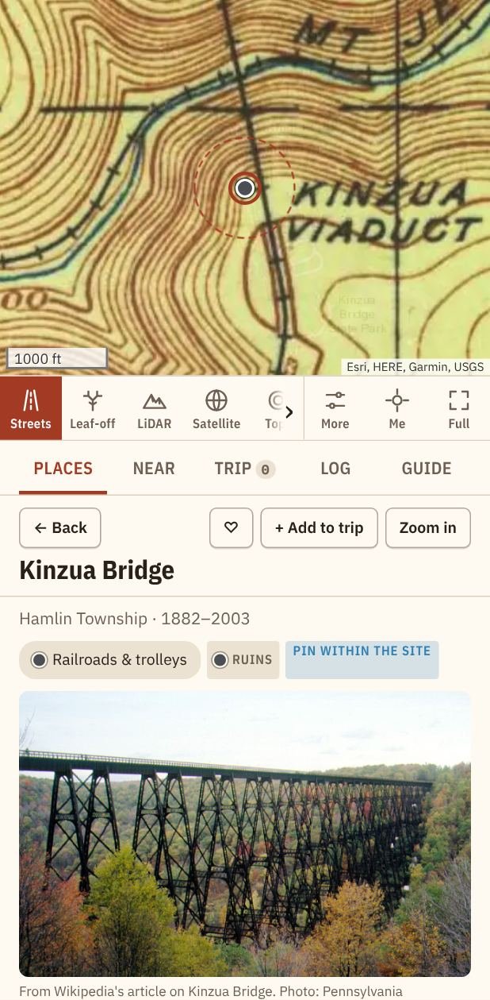</a> <b>A page for every place</b> What was there, what is left to see, a photo, and the old survey map laid over the spot.</td>
<td width="33%" valign="top"><a href="docs/features/03-access.jpg">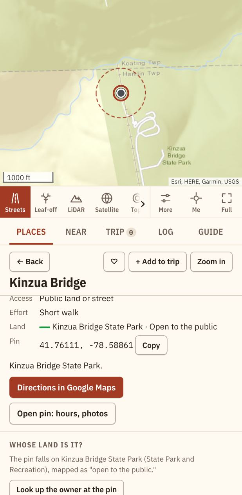</a> <b>How to get there, legally</b> Whose land it is, how far the walk is, directions, and a way to look up the owner. Nothing about getting past a fence.</td>
</tr>
<tr>
<td width="33%" valign="top"><a href="docs/features/04-filters.jpg">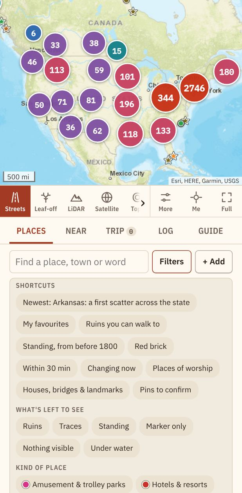</a> <b>Filters</b> Ruins you can walk to, standing since before 1800, red brick, places of worship, within 30 minutes, and by kind of place.</td>
<td width="33%" valign="top"><a href="docs/features/05-compare.jpg">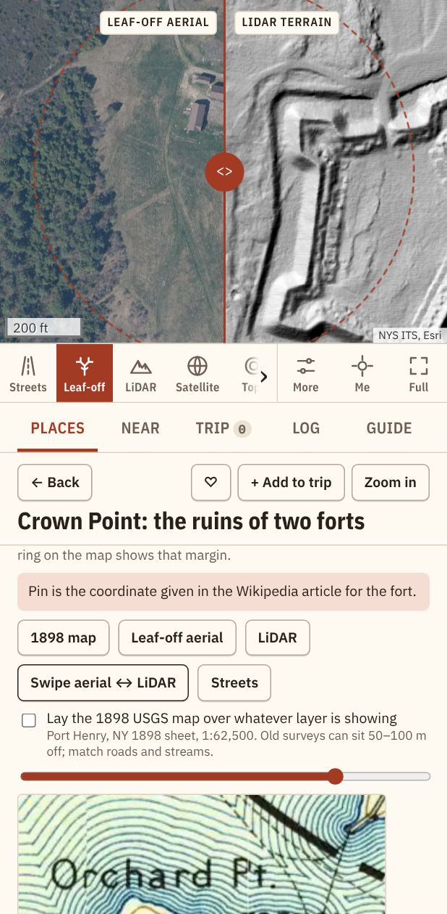</a> <b>See through the trees</b> Swipe between a bare-tree aerial photo and LiDAR terrain. Here the walls of the forts at Crown Point, New York.</td>
<td width="33%" valign="top"><a href="docs/features/06-lines.jpg">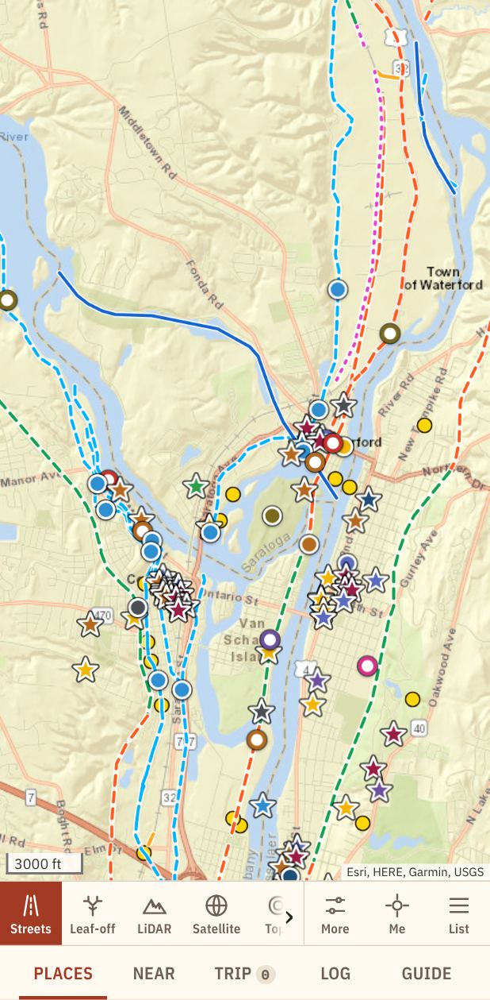</a> <b>Old rails, canals and leads</b> Abandoned rail and trolley lines, canals, and unchecked leads: mapped ruins, vanished places, old mines and quarries.</td>
</tr>
<tr>
<td width="33%" valign="top"><a href="docs/features/07-oldtowns.jpg">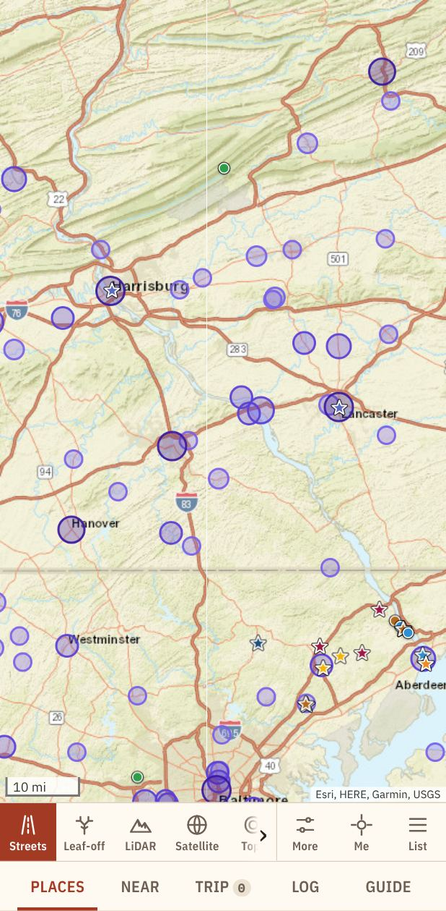</a> <b>Old towns</b> Circles mark old town centres and clusters of historic markers and listed buildings, for finding ground worth a walk.</td>
<td width="33%" valign="top"><a href="docs/features/08-near.jpg">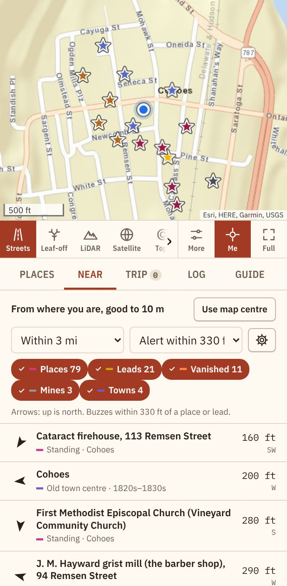</a> <b>Near me</b> Lists what is close, nearest first, with a direction arrow, and buzzes when you walk within range of a place or lead.</td>
<td width="33%" valign="top"><a href="docs/features/09-trip.jpg">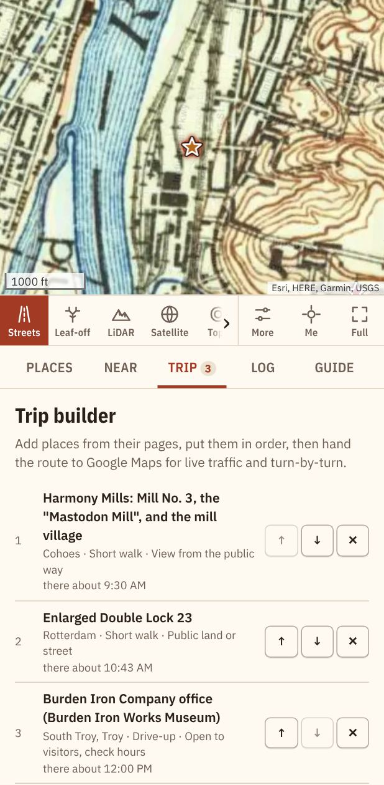</a> <b>Trip builder</b> Put places in order, see when you would reach each, and hand the route to Google Maps.</td>
</tr>
<tr>
<td width="33%" valign="top"><a href="docs/features/10-log.jpg">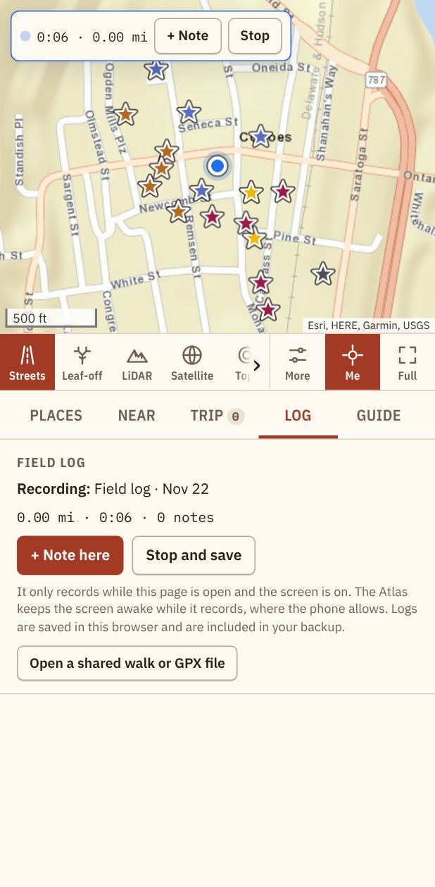</a> <b>Field log</b> Records your track and your notes as you walk. Afterwards it makes chapters, a description and a route map for a video.</td>
<td width="33%" valign="top"><a href="docs/features/11-options.jpg">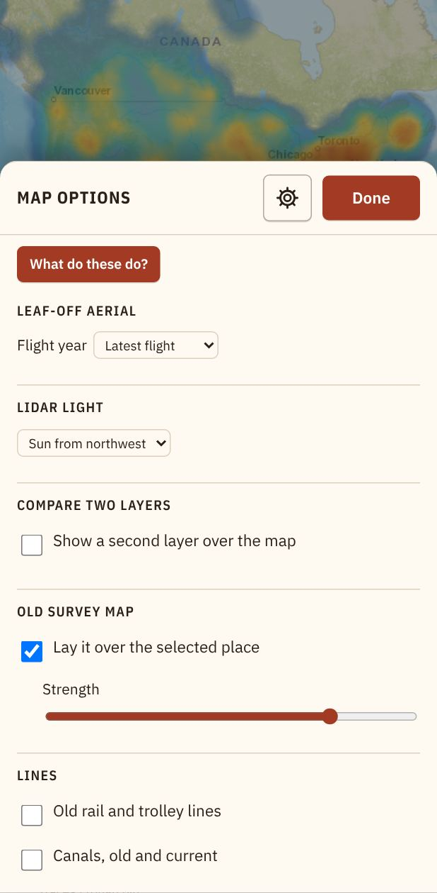</a> <b>Map options</b> Pick the year of the aerial flight, the light on the LiDAR, the layers to compare, and save a map view for offline.</td>
<td width="33%" valign="top"><a href="docs/features/12-dark.jpg">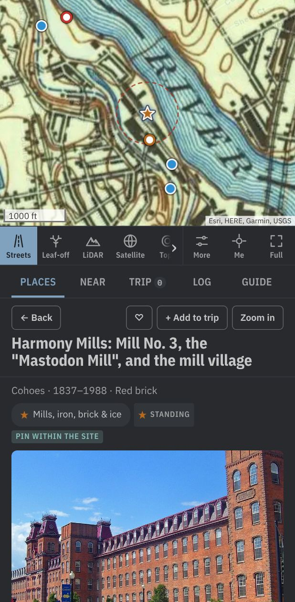</a> <b>Light and dark</b> Nine colour schemes, among them true black and two high-contrast ones, or follow the phone.</td>
</tr>
</table>

Tap a picture to see it full size. Photographs shown in the screenshots: Kinzua Bridge by the Pennsylvania Department of Conservation and Natural Resources ([CC BY-SA 3.0](https://commons.wikimedia.org/wiki/File:Phot_kinzuabridge2.jpg)), Harmony Mills by Daniel Case ([CC BY 2.5](https://commons.wikimedia.org/wiki/File:Harmony_Mills,_Cohoes,_NY.jpg)), both from Wikimedia Commons.

## How to use it

1. **Open the link** above, on a phone or a computer. Zoomed out, colour shows where the places are thick; double-tap or pinch to zoom in, and tap a pin to open its page.
2. **Say where you start** ("Use my location" or "Choose a place"). Drive times and "nearest first" count from there.
3. **Narrow it down** with the search box and Filters on the Places tab.
4. **Change the map** with the bar under it: streets, bare-tree aerial, LiDAR, satellite, old topo maps. "More" holds the rest.
5. **Out walking,** tap Me to see your dot, and open the Near tab for what is close.
6. **Planning a day,** tap "+ Add to trip" on each place, then open the Trip tab. Before you lose signal, use "Save for offline" on a place page or in Map options.
7. **Found something?** "I was here" on a place page and "+ Add" on the Places tab each end in a button that sends it to the public Atlas.

The Guide tab in the Atlas explains the layers and the buttons.

## Where each layer reaches

| Layer | Covers |
|---|---|
| Places | The United States and Canada, densest in New York and New England |
| Unchecked leads from OpenStreetMap | Every state, the District of Columbia and the ten provinces |
| Old towns, vanished places, old mines and quarries | Every state and the District of Columbia |
| Old rail, trolley and canal lines | New York, the six New England states, New Jersey and Pennsylvania |
| LiDAR terrain | Most of the United States: a state's own where it publishes one, the national elevation service elsewhere |
| Bare-tree aerial photos | The states that publish them (see Data credits) |
| Stone walls and sites found on LiDAR | Parts of New York and Massachusetts |

A lead is not a checked place: it is a dot somebody mapped or a name from an old list, and nobody here has confirmed what is there or whose land it is.

## What is in this repository

| Path | What it is |
|---|---|
| `index.html` | The page, with the place list built in |
| `app.js`, `leaflet.js` | The app and the map library |
| `sw.js` | Keeps the Atlas on the phone so it opens with no signal |
| `data/lines.json` | Every old railroad, trolley line and canal in one file; the Android app reads it |
| `data/lines/` | The same lines cut up by state, fetched by the page as the map goes there |
| `data/leads.json` | Unchecked leads from OpenStreetMap, loaded when the Leads layer is switched on |
| `topo/` | One old USGS survey map per place, loaded when that place is opened |
| `source/` | The files the site is built from |
| `boot.js`, `version.json` | Read by the Android app only |
| `android-app/` | The Android app |
| `GUIDE.md` | How the Atlas works and how to add places to it. Start here if you want to help |
| `docs/features/` | The screenshots above, taken by `source/tools/shots.js` |

Notes, progress, field logs and added places are saved in the visitor's own browser. Nothing is uploaded here.

## Helping out

New places, corrected pins and field reports are welcome. **You do not need to know GitHub:** in the Atlas, "I was here" on a place page and "+ Add" each end in a "Send to the public Atlas" button, and the [Suggest a place](https://github.com/Mrroot3r/Lost-and-Hidden-Atlas/issues/new?template=lead.yml) and [Report a visit](https://github.com/Mrroot3r/Lost-and-Hidden-Atlas/issues/new?template=visit.yml) forms do the same from here. A name and a spot are enough; what you send is checked before the map changes, and it is public. `GUIDE.md` explains the place format and the research rules that keep the map trustworthy. Changes come in as pull requests; nothing is pushed straight to `main`, because merging publishes the site.

## Licence

The Atlas's own work (the places, their write-ups and pins, the notes and the code) is free to use and build on with credit: CC BY 4.0. Photographs and the layers that come from other sources keep their own terms. See [LICENSE.md](LICENSE.md).

## Data credits

Imagery: New York State ITS Geospatial Services, MassGIS, Vermont Center for Geographic Information, RIGIS and the URI Environmental Data Center, New Jersey Office of GIS, CT ECO (University of Connecticut), NH GRANIT (University of New Hampshire), Pennsylvania Emergency Management Agency through PASDA, Maine GeoLibrary, Kansas NG911 through the Kansas Geological Survey, USGS (including the 3DEP elevation service), Esri.
Lines and leads: OpenStreetMap contributors, OpenHistoricalMap, MassGIS, U.S. DOT.
Public land: USGS PAD-US. Parcels: NYS tax parcel file, NYS DEC, MassGIS.
